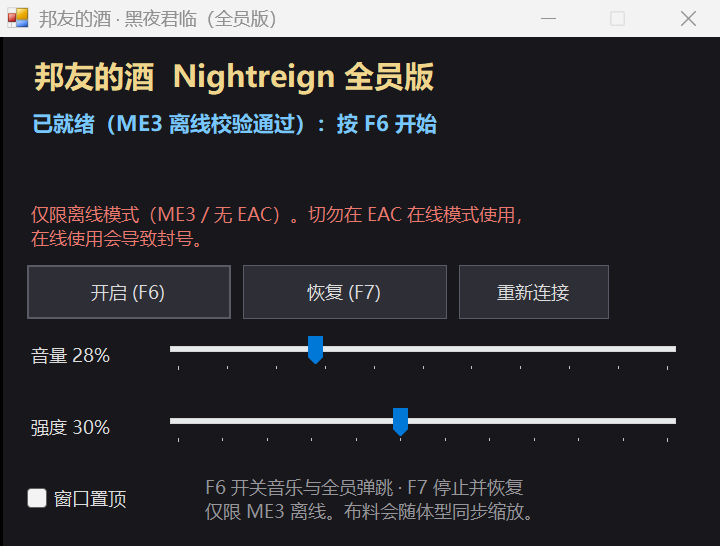

# 邦友的酒 · 黑夜君临（全员版）

把《怪物猎人世界》《街头霸王6》里的“邦友的酒”效果搬到《艾尔登法环：黑夜君临》：
随音乐节奏让**所有已加载的角色**——玩家、怪物、NPC——一起做果冻式压扁 / 拉伸，布料（披风、裙摆）也会跟着体型一起弹。



> 本项目只包含 mod 源码，不包含游戏资源、音乐文件与 ME3 本体。

---

## ⚠️ 封号警告（务必阅读）

- 本工具通过**读写游戏进程内存**实现，只允许在 **ME3 离线模式** 使用。
- **绝对不要在 EAC 在线模式使用。** 在线修改属于作弊 / 篡改，会导致封号。
- 程序内置拒绝逻辑：
  - 进程中出现 Easy Anti-Cheat 模块 → 拒绝连接；
  - 启动链中出现 `start_protected_game` / EAC → 拒绝连接；
  - 游戏不是通过 ME3 启动 → 拒绝连接。
- 工具**不读写存档文件**，只改运行中的内存。

---

## 功能

- 播放 WAV，按 BPM（默认 133.333）对全体角色做 Y 轴拉伸 + X/Z 泊松收缩，脚底贴地；
- 每 0.5 秒重新枚举角色，换图、重生、角色进出视野自动跟上；
- 布料同步：抵消游戏每帧写入的 `1/体型缩放` 补偿，披风、裙摆跟随体型；
- F6 / F7 全局热键、音量 / 强度实时调节、关闭自动恢复；
- 逐角色内存校验（RTTI、chr↔ctrl 指针、体型范围），非法角色直接跳过。

---

## 编译

需要 Windows + .NET Framework 4.x（Win10/11 自带），无需 Visual Studio。

```bat
BUILD.bat
```

输出：`bin\BydjNightreign.exe`。等价命令：

```bat
C:\Windows\Microsoft.NET\Framework64\v4.0.30319\csc.exe -nologo -codepage:65001 ^
  -target:winexe -platform:x64 -optimize+ -out:bin\BydjNightreign.exe ^
  -r:System.Windows.Forms.dll -r:System.Drawing.dll ^
  src\BydjNightreign.cs src\GameMemoryAll.cs
```

运行时把 `BydjNightreign.exe`、`BydjNightreign.ini` 和 WAV 放在同一目录；游戏需用 ME3 离线启动。

---

## 实现要点

目标版本：游戏 **1.03.3** / regulation **1.03.5**，Windows 11 x64。

### 指针链

| 路径 | 说明 |
| --- | --- |
| 模块内特征码 `48 8B 05 ?? ?? ?? ?? 0F 28 F1 48 85 C0` | 定位 WorldChrMan 全局槽 |
| `man + 0x174E8` | 本地玩家 chr |
| `chr + 0x60` | ctrl（体型写入点） |
| `ctrl + 0x2E4 / 0x2E8 / 0x2EC` | 体型缩放 vec3（每帧写 12 字节） |
| `man + 0x16438` | ChrSet 持有者数量 |
| `man + 0x16440 + i*0x18` | ChrSet 指针数组 |
| `set + 0x18` | 角色条目数组（每条 0x10：chr 指针 + 状态字节） |

所有角色都在未缩放空间里播放动画，体型缩放由模型 / ctrl 层统一应用，所以直接写 `ctrl+0x2E4` 就能让任意角色弹跳。

### 布料同步（核心补丁）

游戏每帧把布料骨骼的缩放写成 `1/体型缩放`，用来抵消模型层缩放，因此原版披风不会跟着变大变小。

执行顺序（每帧）：

1. 常规转换循环（RVA `0x17EA543`）写入 `源缩放 × 父级缩放`；
2. 布料混合循环在栈上构建骨骼，然后通过 RVA `0x2847E63` 的 `call` 调用 `0x154FA0` 的拷贝函数，把栈上骨骼（缩放 = 1/体型缩放）**覆盖**写进姿态。

补丁做法：

- 把 `0x2847E63` 处的 5 字节 `call`（特征 `48 8D 0C 7F 48 C1 E1 04 48 03 4B 18 E8 38 D1 90 FD`）重定向到模块内一段 ≥64 字节的 `0xCC` 代码洞；
- 代码洞里照常复制 T、Q，但把 S 固定写成 `(1,1,1,0)`：

```asm
movups xmm0,[rdx]        ; T
movaps [rcx],xmm0
movups xmm0,[rdx+10h]    ; Q
movaps [rcx+10h],xmm0
movups xmm0,[rdx+20h]    ; S
movups xmm1,[rip+9]      ; (1,1,1,0)
movaps xmm0,xmm1
movaps [rcx+20h],xmm0
ret
```

- 写入前挂起游戏全部线程，避免执行到半条指令；F7 时把原始 `call` 字节与代码洞原样写回。

由于 live pose 处于未缩放空间，S=1.0 时布料由模型缩放统一带动，拉伸和压扁都能同步。实测体型缩放 0.74–1.30 变化时，全部布料骨骼 S 恒为 `1.000`。

---

## 已知限制

- 镜头跟随缩放、自转效果未移植；
- 强度过高（>50%）时手脚、武器与布料之间可能穿模；
- 游戏更新后特征码 / RVA 可能失效，需要重新定位（布料补丁的两处 RVA 最可能变化）。

---

## 许可证

本项目源码采用 [MIT](LICENSE)。

- 音乐《邦友的酒》版权归原作者，**不包含**在本仓库中；运行需自备 16-bit PCM WAV。
- ME3 为第三方开源工具（MIT / Apache-2.0），版权归其作者，**不包含**在本仓库中。
- 《ELDEN RING NIGHTREIGN》相关版权归 FromSoftware / Bandai Namco 所有。本项目与官方无关。
